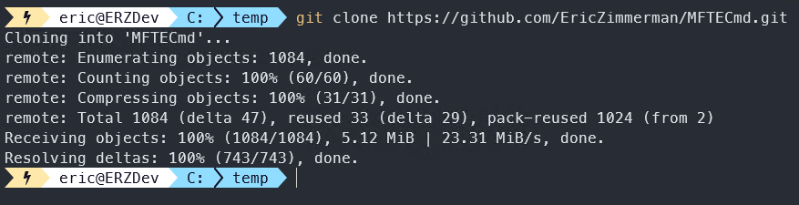
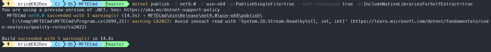
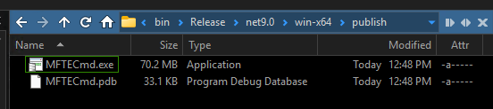

---
hide:
  - navigation
---

# 📦 How to build self-contained executables

The downloads need the .NET runtime installed. If you would rather not install it, on a forensic workstation or a
machine you don't control for example, you can build any command line tool yourself as **one self-contained file**
with the runtime inside it.

!!! info "The tradeoff"

    The normal .NET 10 MFTECmd is **2.6 MB** in 3 files and needs the .NET 10 runtime. Built self-contained, it is
    **one 72.6 MB file** that needs nothing else. Same tool, same output.

## 🧰 What you need

- [git](https://git-scm.com/downloads)
- The [.NET 10 SDK](https://dotnet.microsoft.com/download/dotnet/10.0) (the SDK, not only the runtime)

## 🛠️ Steps

This example builds MFTECmd. Every command line tool works the same way.

1. **Clone the repository.** Open a shell (PowerShell, for example), go to where you want it (here `C:\Temp`) and run:

    ```text
    git clone https://github.com/EricZimmerman/MFTECmd.git
    ```

    

2. **Go into the repository:**

    ```text
    cd C:\Temp\MFTECmd
    ```

3. **Build it.** Pick the system it will run on:

    === "Windows"

        ```text
        dotnet publish -f net10.0 -r win-x64 -p:PublishSingleFile=true --self-contained true -p:IncludeNativeLibrariesForSelfExtract=true
        ```

    === "Linux"

        ```text
        dotnet publish -f net10.0 -r linux-x64 -p:PublishSingleFile=true --self-contained true -p:IncludeNativeLibrariesForSelfExtract=true
        ```

    === "macOS (Apple silicon)"

        ```text
        dotnet publish -f net10.0 -r osx-arm64 -p:PublishSingleFile=true --self-contained true -p:IncludeNativeLibrariesForSelfExtract=true
        ```

    

4. **Find the result** in the `publish` folder, for Windows
   `C:\Temp\MFTECmd\MFTECmd\bin\Release\net10.0\win-x64\publish`:

    

5. ✅ **Test it** before you rely on it: run it with `--help`, then on some test data.

The screenshots show .NET 9 (`net9.0`); use the `net10.0` commands and paths above.

!!! tip "Good to know"

    - Repeat the steps for every tool you want; each one is built from its own repository.
    - Some tools only run on Windows whatever you build them for: SrumECmd and SumECmd (they use Windows' ESE
      database engine) and VSCMount.
    - `IncludeNativeLibrariesForSelfExtract=true` puts native libraries (the SQLite files of AmcacheParser, WxTCmd
      and SQLECmd) inside the file, and .NET extracts them to a temporary folder when the tool runs. Leave that option
      out to keep them as files next to the tool instead.
